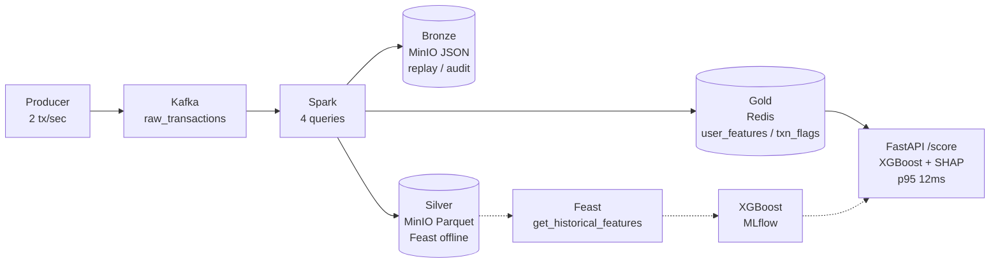

# Real-Time Fraud Detection Feature Store

[](https://github.com/sameeksham09/fraud-feature-store/actions/workflows/ci.yml)


End-to-end ML pipeline that detects fraudulent credit-card transactions in real time, built around a **Medallion (Bronze → Silver → Gold)** streaming feature store with explainable inference.

```
                        ┌─────────────────────────────────┐
                        │     Spark Structured Streaming    │
┌──────────────┐        │     (5-min window, 10-min WM)   │   Bronze (ELT)          ┌──────────┐
│   Producer   │  Kafka │                                 │──► s3://bronze/  JSON ──►│  MinIO   │  replay / audit
│  (synthetic) │──►raw_ │  raw ──► window agg ──► flags   │                         └──────────┘
│  2 tx/sec    │  txns  │   │                              │   Silver (Parquet)      ┌──────────┐
└──────────────┘        │   │  query0: Bronze              │──► s3://silver/ ──────►│  Feast   │  offline training
                        │   │  query1: Gold → Redis        │                         │  FileSrc │
                        │   │  query2: Gold → Redis        │   Gold (Redis)          └──────────┘
                        │   │  query3: Silver → MinIO      │──► user_features:* ──┐
                        └─────────────────────────────────┘   txn_flags:*     │   ┌──────────────┐
                                                                              └───►│   FastAPI    │──► XGBoost (MLflow)
                                                                                   │  /score      │    + SHAP explain
                                                                                   │  /explain    │    p95 < 15ms
                                                                                   └──────────────┘
```



**Producer** generates synthetic transactions onto Kafka topic `raw_transactions`.
**Spark Structured Streaming** lands raw events to **Bronze** (MinIO JSON, replay log), then computes 5-minute tumbling windowed aggregates and per-transaction flags and writes them to **Redis (Gold)** and **MinIO/Silver (Parquet)**.
**Feast** declares a feature view over the Silver Parquet and is used for historical training via `get_historical_features()`. The live API does **not** go through Feast — it reads Gold aggregates directly from Redis.
**XGBoost** is trained on synthetic data, tracked in **MLflow**.
**FastAPI** reads user features from Redis at request time, scores with XGBoost, and returns **fraud probability + SHAP reasons**.

> **Live docs:** `http://localhost:8000/docs` (FastAPI auto-generated OpenAPI) · **Metrics:** `http://localhost:8000/metrics` · **Grafana:** `http://localhost:3000` · **Load test:** `load/k6_score.js` (`make load-k6`)

## Why this architecture

Real-time fraud detection needs two very different kinds of features at the same time:

- **Windowed aggregates over recent history** (5-minute txn count, total amount, etc.) — these are *streaming* features that change continuously and must be served in single-digit milliseconds.
- **Historical features for offline training** (the same windowed features, but back-filled) — for the model to learn from, queried in batch.

The **Medallion** split is the answer:

| Layer | Store | Format | Purpose |
|-------|-------|--------|---------|
| **Bronze** | MinIO `s3://features/bronze/raw_transactions/` | JSON | Raw, immutable replay log — audit + schema evolution without re-consuming Kafka |
| **Silver** | MinIO `s3://features/windowed_features/` | Parquet | Cleaned windowed aggregates — Feast offline store |
| **Gold** | Redis `user_features:{user_id}` / `txn_flags:{txn_id}` | Hash | Latest per-user features for <10ms online serving |

**Feast** is the abstraction layer over Silver — it gives the training pipeline point-in-time-correct historical features without hand-rolling that logic. The serving API skips Feast entirely and reads Gold directly, since it needs the *live* streaming aggregates rather than a materialized snapshot.

> **Interview talking point:** "Hybrid ELT + ETL — Bronze is ELT (land raw first), Silver/Gold are ETL (transform then load). Feast is intentionally *not* on the live path to avoid materialization lag."

## Prerequisites

- **Docker** (for Kafka, Redis, MinIO, Zookeeper, kafka-ui, Prometheus, Grafana)
- **Python 3.9+** with `venv`
- **Java 11+** (PySpark requirement)
- Kafka connector JARs in `spark/jars/` (already present: `spark-sql-kafka`, `kafka-clients`, `hadoop-aws`, `aws-java-sdk-bundle`, `commons-pool2`, `spark-token-provider-kafka`)

## Quick start (Makefile)

```bash
make help      # list all commands
make up        # docker compose up -d (kafka:9092, redis:6379, minio:9001, grafana:3000)
make produce   # terminal A — 2 tx/sec
make spark     # terminal B — 4 streaming queries (bronze→S3, windows→Redis, flags→Redis, silver→S3)
make train     # XGBoost synthetic 10k
make api       # uvicorn :8000
make health    # curl /health + /score smoke test
make test      # pytest
make down      # stop infra
```

Or run each phase manually:

## Running the system

### 1. Start infrastructure

```bash
docker compose up -d
# or: make up
```

This brings up:
- **Kafka** on `localhost:9092` (external) / `kafka:29092` (internal Docker network)
- **Zookeeper** on `localhost:2181`
- **kafka-ui** at <http://localhost:8080>
- **Redis** on `localhost:6379`
- **MinIO** on `localhost:9000` (API) / `localhost:9001` (console — `minioadmin` / `minioadmin`)
- **Prometheus** on `localhost:9090`
- **Grafana** on `localhost:3000` (admin/admin)

A one-shot `minio-init` sidecar automatically creates the `features` bucket in MinIO on first start (using `mc mb --ignore-existing`, so it's safe to re-run). Spark's writers target `s3a://features/bronze/` and `s3a://features/windowed_features/` and rely on this bucket existing.

### 2. Set up the Python environment

```bash
python3 -m venv venv
source venv/bin/activate
pip install -r requirements.txt
pip install -r producer/requirements.txt
pip install -r spark/requirements.txt
# Optional: real SHAP values (otherwise importance_fallback is used)
pip install "shap>=0.44.0"
```

`s3fs` is needed by Feast's offline store to read Parquet from S3.

### 3. Produce transactions (terminal A)

```bash
python producer/produce_transactions.py
# or: make produce
```

~3% fraud rate, 200 users, 2 transactions/second. You can watch them in <http://localhost:8080> (kafka-ui).

### 4. Run the Spark feature pipeline (terminal B)

```bash
python spark/feature_engineering.py
# or: make spark
```

Four streaming queries:

| Query | Sink | Trigger |
|-------|------|---------|
| **query0** → raw transactions → MinIO **Bronze** (`s3a://features/bronze/raw_transactions/` JSON) | S3/MinIO | 30s |
| **query1** → windowed features → Redis **Gold** (`user_features:{user_id}`) | Redis | 30s |
| **query2** → transaction flags → Redis **Gold** (`txn_flags:{txn_id}`) | Redis | 10s |
| **query3** → windowed features → MinIO **Silver** (`s3a://features/windowed_features/` Parquet) | S3/MinIO | 30s |

The 5-minute tumbling window uses a 1-minute slide. Watermark is 10 minutes.

### 5. (Optional) Register the feature view for historical training

```bash
export AWS_ACCESS_KEY_ID=minioadmin
export AWS_SECRET_ACCESS_KEY=minioadmin
cd feast
feast apply
cd ..
```

This writes the registry to `feast/registry.db` and is only required if you want to build historical training sets via Feast's `get_historical_features()` against the Silver Parquet in `s3://features/windowed_features/`. **It is not required for the live `/score` API**, which reads windowed aggregates directly from Redis under the `user_features:{user_id}` keys written by Spark.

### 6. Train the model (run once, or after schema changes)

```bash
python models/train.py
# or: make train
# Historical mode (requires Parquet in MinIO):
python models/train.py --historical
# or: make train-historical
```

Trains an XGBoost classifier on a synthetic 10k-row dataset. Feature order must match `FEATURE_ORDER` in `api/main.py`. Logs params, metrics, and a feature-importance plot to the `fraud_detection` MLflow experiment (`./mlruns`).

> **Note on training data.** The training set is generated synthetically with `is_fraud` as a deterministic function of the features (see `models/train.py`). The model is essentially learning a hand-coded rule, so the reported metrics measure *fit to that rule*, not real-world fraud detection. In production, the labels would come from delayed chargeback reports, not from the streaming pipeline.

### 7. Serve predictions (terminal C)

```bash
uvicorn api.main:app --reload --port 8000
# or: make api
```

Endpoints:

| Method | Path | Description |
|--------|------|-------------|
| `POST` | `/score` | `{user_id, amount, merchant_category, merchant_country}` → `{fraud_probability, risk_level, features_used, redis_features_found, latency_ms}` |
| `POST` | `/score?explain=true` | Same as `/score` + `explainability: {shap_values, top_contributors[3], reasons[], method}` |
| `POST` | `/explain` | Dedicated explainability endpoint — always returns `explainability` |
| `GET` | `/user/{id}` | Raw Redis features for one user |
| `GET` | `/health` | Model + Redis status |
| `GET` | `/metrics` | Prometheus scrape endpoint |

Risk thresholds: `>0.7` HIGH, `>0.4` MEDIUM, else LOW.

**Explainability** uses `shap.TreeExplainer` when `shap` is installed, otherwise falls back to XGBoost `feature_importances_` weighted by normalized feature values. It never breaks scoring. Human reasons are derived from domain thresholds (`is_suspicious`, `is_high_amount`, velocity).

```bash
# Normal scoring
curl -X POST http://localhost:8000/score \
  -H "Content-Type: application/json" \
  -d '{"user_id":"user_0001","amount":1500,"merchant_category":"electronics","merchant_country":"NG"}' | jq .

# With SHAP reasons (opt-in)
curl -X POST "http://localhost:8000/score?explain=true" \
  -H "Content-Type: application/json" \
  -d '{"user_id":"user_0001","amount":2500,"merchant_category":"travel","merchant_country":"RU"}' | jq .

# Dedicated explain endpoint
curl -X POST http://localhost:8000/explain \
  -H "Content-Type: application/json" \
  -d '{"user_id":"user_0001","amount":2500,"merchant_category":"travel","merchant_country":"RU"}' | jq .
```

Example `explainability` response:

```json
{
  "fraud_probability": 0.91,
  "risk_level": "HIGH",
  "explainability": {
    "method": "shap",
    "shap_values": {"is_suspicious": 0.42, "max_amount_5min": 0.31, "txn_count_5min": 0.08},
    "top_contributors": [
      {"feature": "is_suspicious", "feature_value": 1.0, "contribution": 0.42, "direction": "increases risk"},
      {"feature": "max_amount_5min", "feature_value": 2500.0, "contribution": 0.31, "direction": "increases risk"}
    ],
    "reasons": [
      "Foreign transaction exceeds suspicious threshold ($200) — country=RU",
      "High-value transaction ($2500.00 > $500 threshold)"
    ]
  }
}
```

### 8. Inspect runs

```bash
mlflow ui --port 5000
# or: make mlflow
```

Experiment: `fraud_detection`.

## Verifying it works

```bash
# Check Kafka is receiving messages
open http://localhost:8080   # kafka-ui → raw_transactions topic

# Check Spark is writing features to Redis
redis-cli HGETALL user_features:user_0001

# Check Bronze + Silver in MinIO
docker exec -it $(docker ps -qf name=minio) mc ls --recursive local/features/
# → bronze/raw_transactions/  +  windowed_features/

# Hit the scoring API (normal + explainable)
make health
curl -X POST "http://localhost:8000/score?explain=true" \
  -H "Content-Type: application/json" \
  -d '{"user_id":"user_0001","amount":1500,"merchant_category":"electronics","merchant_country":"NG"}' | jq .
```

A healthy response will have `"redis_features_found": true` and all four `txn_count_5min`/`total_amount_5min`/`avg_amount_5min`/`max_amount_5min` fields populated in `features_used`.

## Architecture notes & tradeoffs

### Medallion (Bronze / Silver / Gold)

Spark writes the same ingestion to three layers:

- **Bronze (MinIO `s3a://features/bronze/raw_transactions/` JSON)** — raw events, landed *before* any transform. Enables replay, audit, and schema evolution without re-consuming Kafka. This is the ELT half.
- **Silver (MinIO `s3a://features/windowed_features/` Parquet)** — cleaned 5-minute windowed aggregates. This is the offline store that Feast reads.
- **Gold (Redis `user_features:{user_id}` hash, TTL 24h + `txn_flags:{txn_id}` TTL 1h)** — latest per-user features for online serving. The FastAPI API reads from these keys directly at request time.

`feast/features.py` declares the feature view over the Silver Parquet. It is **not** used for live serving — it's there for `get_historical_features()` to build point-in-time-correct training sets when you graduate from the synthetic dataset in `models/train.py` to real labeled data.

If you ever want to use Feast for online serving too, you can run `feast materialize-incremental` on a schedule to copy the latest offline values into Feast's Redis keyspace. The current architecture deliberately skips this step so the API sees live streaming aggregates, not stale materialized snapshots.

### Kafka dual listeners

The producer and Spark both connect to Kafka on `localhost:9092` (the *external* listener, exposed by Docker to the host). Containers within the Docker network talk to each other on `kafka:29092` (the *internal* listener). Don't change `KAFKA_ADVERTISEDED_LISTENERS` in `docker-compose.yml` without updating both clients.

### MinIO/S3 alignment

The `minio-init` sidecar in `docker-compose.yml` creates the `features` bucket in MinIO on first start (idempotent via `mc mb --ignore-existing`). Once that runs, Spark's offline writers can land Parquet/JSON in `s3a://features/bronze/` and `s3a://features/windowed_features/`, and the Feast `FileSource` (which reads from `s3://features/windowed_features/`) sees the same data — same bucket, different protocol.

- **For Spark writes** — `spark/feature_engineering.py:30-33` configures `spark.hadoop.fs.s3a.access.key`, `s3a.secret.key`, `s3a.endpoint`, and `s3a.path.style.access=true` directly in the Spark session.
- **For the Feast `FileSource`** — `feast/features.py` passes `s3_endpoint_override="http://localhost:9000"` to the `FileSource` constructor. This is the per-data-source knob that Feast 0.34 uses to point pyarrow's S3FileSystem at MinIO. PyArrow reads the AWS access key/secret from the environment.
- **For the API** — the API does **not** talk to MinIO directly. It reads windowed features from Redis (where Spark writes them), so no S3 env vars are needed at runtime.

When running the `feast` CLI directly (e.g. `feast apply`), set the AWS env vars in your shell so PyArrow can authenticate with MinIO:

```bash
export AWS_ACCESS_KEY_ID=minioadmin
export AWS_SECRET_ACCESS_KEY=minioadmin
```

Feast 0.34's `file` offline store config in `feature_store.yaml` is intentionally minimal — only the `type` field is supported. S3 configuration lives on the `FileSource` itself, not at the repo level.

### Explainability tradeoff

`api/explain.py` uses `shap.TreeExplainer` when `shap` is installed (≈ +15ms per request) and falls back to XGBoost global importances weighted by normalized feature activation otherwise. The fallback is free and requires no extra dependency. Both paths also emit human-readable `reasons` from domain thresholds (`SUSPICIOUS_AMOUNT_THRESHOLD`, `HIGH_AMOUNT_THRESHOLD`, velocity). Explainability is opt-in (`?explain=true` or `/explain`) so the default `/score` path stays at p95 < 15ms.

### Partitioning tradeoff

Spark's `query0` (Bronze JSON) and `query3` (Silver Parquet) each write one file per micro-batch (every 30 seconds) without date partitioning. At demo scale this is fine. At higher volumes, you'd want `partitionBy("event_date")` in the writeStream to avoid a full bucket scan whenever `get_historical_features()` builds a training set from Silver Parquet. This is the most obvious next optimization.

### Production notes

- **Kafka replication:** `docker-compose.yml` sets `KAFKA_OFFSETS_TOPIC_REPLICATION_FACTOR=1` for single-broker local dev. Production override is `docker-compose.prod.yml` (`replication=3`, `API_KEYS` required via `${API_KEYS:?...}`) — run `API_KEYS=<secret> make up-prod`.
- **Secrets:** copy `.env.example` → `.env` (`cp .env.example .env`), fill `API_KEYS`, never commit `.env` (gitignored). Compose reads `.env` automatically. `docker-compose.prod.yml` fails fast if `API_KEYS` is missing.
- **Data quality:** invalid rows in `spark/feature_engineering.py` are validated by `spark/validation.py` and quarantined to `s3://features/quarantine/invalid_records/` (S3 via `s3fs`/`boto3`, fallback `/tmp/quarantine/`) + structured log + `fraud_quarantined_total` counter. Quarantine I/O never kills the streaming query.
- **Security:** API key via `X-API-Key` header (`api/auth.py` uses `hmac.compare_digest`), rate limit 100/min IP / 1000/min key with `X-RateLimit-*` + `Retry-After` headers, security headers (`X-Content-Type-Options: nosniff`, etc.). See `load/k6_score.js`.
- **Load test:** `make load-k6` (or `make load-k6-docker` without local k6) hits `/score` with 50 VUs / 30s; thresholds `p(95)<50ms` (tighten to 15ms when warm). Results in `load/results.md` — update the p95 badge after your first run.

### Feature contract

`FEATURE_ORDER` in `api/main.py` must match the column order used in `models/train.py` and the schema declared in `feast/features.py`. Changing the feature set requires retraining. The Feast feature view currently exposes only the 4 windowed features; the 3 transaction-level flags (`is_foreign`, `is_high_amount`, `is_suspicious`) are computed at request time in the API from the request payload, not served from the feature store. `features/__init__.py` is the single source of truth for their thresholds.

## Project layout

```
fraud-feature-store/
├── api/                          # FastAPI scoring service
│   ├── main.py                   # /score, /score?explain=true, /explain, /health, /metrics
│   ├── explain.py                # SHAP + human reasons (optional shap dep)
│   ├── auth.py / rate_limit.py   # API key + rate limiting
│   └── metrics.py                # Prometheus metrics
├── feast/                        # Feast feature store definition (Silver offline)
│   ├── feature_store.yaml
│   ├── features.py
│   └── registry.db               # generated by `feast apply`
├── features/                     # Shared feature thresholds (single source of truth)
│   └── __init__.py               # HIGH_AMOUNT_THRESHOLD, compute_is_*()
├── models/                       # XGBoost training
│   ├── train.py                  # --historical flag for Feast offline mode
│   └── artifacts/                # feature_importance.png
├── producer/                     # Synthetic transaction generator
│   ├── produce_transactions.py
│   ├── transaction_generator.py
│   └── requirements.txt
├── spark/                        # Spark Structured Streaming (Medallion)
│   ├── feature_engineering.py    # query0 Bronze + query1/2 Gold + query3 Silver
│   ├── redis_writer.py
│   ├── validation.py
│   ├── jars/                     # Kafka + S3A connector JARs (gitignored)
│   └── requirements.txt
├── docker-compose.yml            # Kafka, Redis, MinIO, Prometheus, Grafana
├── prometheus.yml
├── requirements.txt              # Root deps (api + ml + feast + monitoring)
├── Makefile                      # make up / produce / spark / train / api / health
├── .gitignore
└── README.md
```
